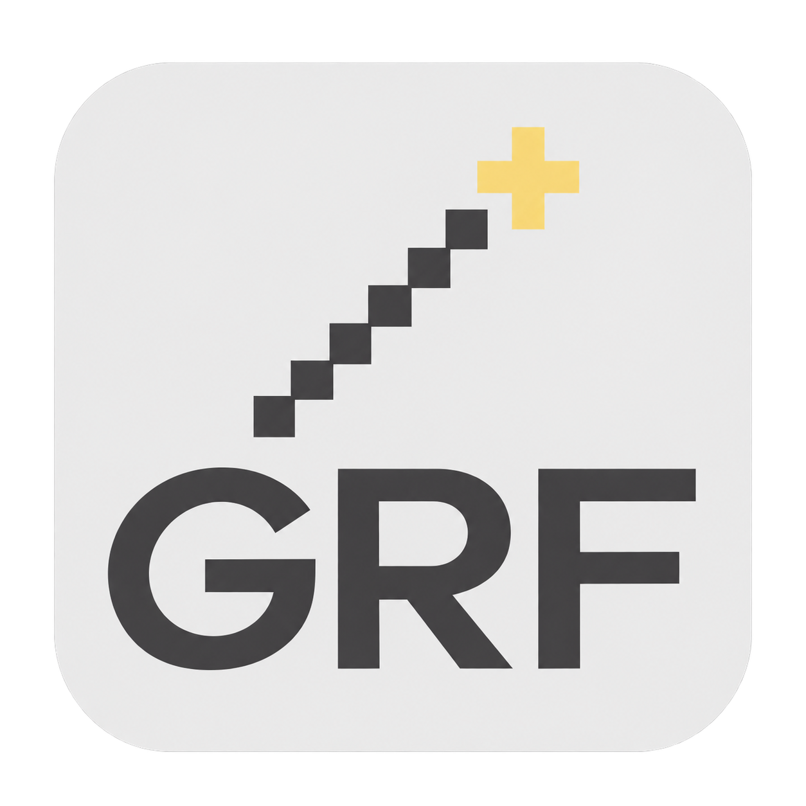
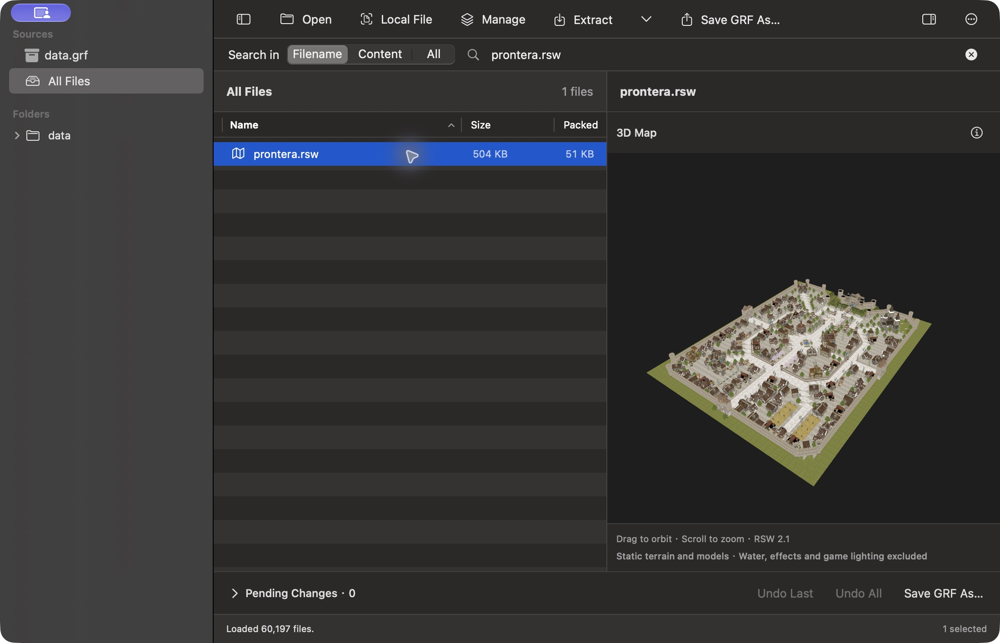
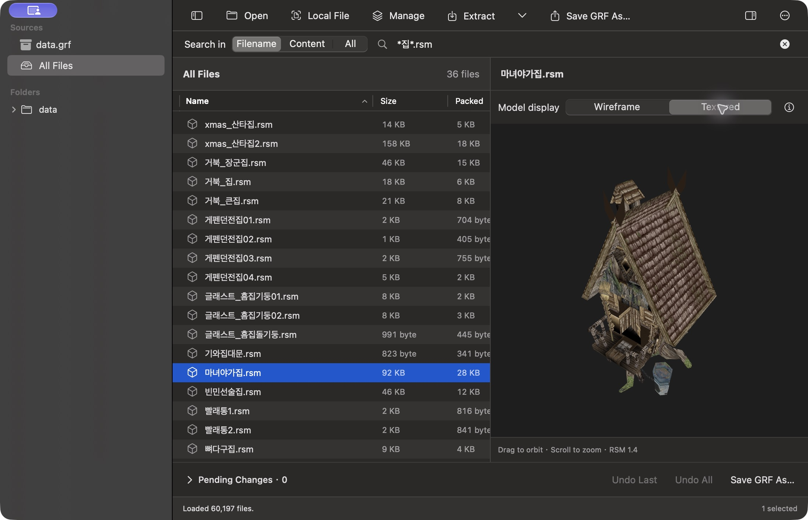
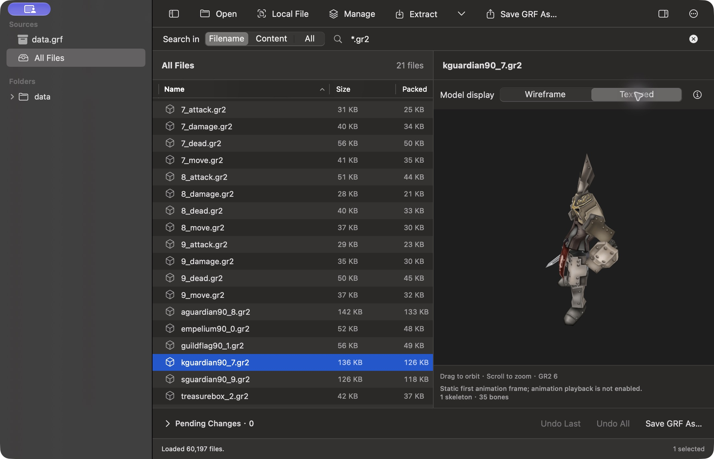
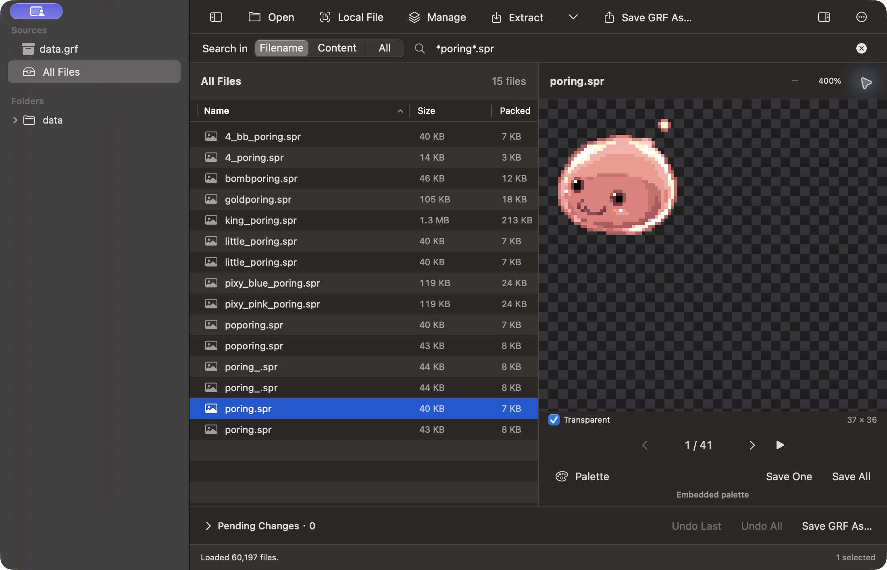

# GRF Tool for macOS

[English](README.md) · [繁體中文](README.zh-TW.md) · **日本語** · [한국어](README.ko.md) · [Credits](credit.md)



Ragnarok Online の GRF／GPF を閲覧・プレビュー・編集する、ネイティブ macOS アプリです。ファイル名やテキストの検索、マップ・モデルの表示、展開、編集後のコピーの保存に対応します。

SwiftUI で **GRF Tool 1.2.0 (`grftool.exe`)**、**GRFBuilder 0.1.30 (`grfbuilder.exe`)**、**SPRViewer (`SPRViewer.exe`)** の作業手順を再構築しています。Windows、Wine、アカウント、サーバーは不要です。元の EXE、ゲームのリソース、専用 SDK はアプリに含まれません。作者・出典・利用方法は [Credits（英語）](credit.md) を参照してください。

## はじめに

**macOS 14 以降**が必要です。ソースからのビルドには **Swift 6** を含む Xcode または Command Line Tools も必要です。

**ダウンロード：**[GRF Tool v1.5.0（Apple Silicon）](https://github.com/stanleylaihk/GRF-tool/releases/download/v1.5.0/GRFToolMac-1.5.0-macOS-arm64.zip)。ZIP を展開し、**GRF Tool.app** を「アプリケーション」に移動してください。配布版は Apple Silicon Mac 用です。Intel Mac ではソースからビルドしてください。[すべてのリリース](https://github.com/stanleylaihk/GRF-tool/releases)も参照できます。

ソースからビルドする場合：

```sh
git clone https://github.com/stanleylaihk/GRF-tool.git
cd GRF-tool
./build-app.sh
open "release/GRF Tool.app"
```

ビルドは実行した Mac のアーキテクチャを対象とします。Apple Silicon と Intel は別々にビルドしてください。生成したアプリはローカルの ad-hoc 署名で、Developer ID 署名・公証は含みません。Finder から開く場合は `.app` を使用してください。開発用には `swift run GRFToolMac` も利用できます。

1. **開く（Open）**を選択するか、`.grf`／`.gpf` をドロップします。
2. 左でソース／フォルダーを選択します。右のワークスペースにはツールバーと検索欄があり、その下にファイル一覧とプレビューが並びます。
3. **ローカルファイル（Local File）**では単独リソースと同じフォルダーのファイルを閲覧できます。開いていた GRF にも戻れます。
4. **展開（Extract）**で取り出すか、**管理（Manage）**で編集し、**Save GRF As…** で別の GRF に保存します。

上部にアーカイブ名を重複表示しません。ツールバーの空白をドラッグするとウィンドウを移動できます。操作部品はホバー時に青く表示され、区切り線で幅を調整できます。サイドバーとプレビューは非表示にもできます。

## 表示言語

**Settings → Interface Language** で **English／繁體中文／日本語／한국어** を選択できます。変更は即座に反映・保存され、再起動は不要です。開いているアーカイブ、検索、プレビューや未保存の変更は保持されます。

表示言語とファイル名・内容の文字コードは独立しています。リソース名、ファイル内容、JSON、ライセンス原文、未対応の低レベル診断は翻訳されません。

## 閲覧・検索

- フォルダーツリー、複数選択、サイズ・圧縮後サイズ、パスのコピー。一部の韓国語フォルダーには英語の補足名を表示しますが、実際のパスは変えません。
- **Filename** は名前／パスを即時検索します。`*`、`?` に対応し、例として `*.spr` を使用できます。
- **Content／All** は Enter または検索ボタンで実行します。追加・置換した下書きも含む、現在のソース全体のテキストが対象です。フォルダーの絞り込みには制限されません。
- 結果には行番号、抜粋、一致数を表示し、プレビューから前後の一致へ移動できます。進行状況・キャンセルに対応し、バイナリや **16 MiB を超えるテキスト**はスキップして報告します。
- 大きな GRF はインデックスを先に読み込み、進行状況とキャンセルを提供します。全内容を一括してメモリに載せません。

## GRF の作成・編集

- **New GRF／⌘N**：空のアーカイブを作成。
- **Manage**：ファイル／フォルダーの追加、GRF の結合、置換、名前変更、削除。結合時の同一パスは、既存を保持・置換・結合をキャンセルから選択できます。
- **Pending Changes**：変更件数を表示。項目単位、直前の操作、すべての変更を取り消せます。一覧とプレビューには下書きが反映されます。
- **Extract**：現在の下書きから展開します。削除した項目は除外し、置換した項目は新しい内容を使います。
- **Save GRF As…**：標準・非暗号化の **GRF 2.0** を別名保存し、保存先を開きます。**Repack As…** はインデックスと圧縮データを再構築しますが、小さくなるとは限りません。

下書きはメモリ内に保持され、元の GRF や結合元を直接変更しません。未保存のまま離れる際は確認します。保存はキャンセル可能で、失敗時も下書きと既存の保存先を保持します。

**⌘,** の設定で圧縮を **Default (balanced)** または **0–9** に指定できます。0 は圧縮なし、1 は最速、9 は最高圧縮です。次回の保存／再圧縮に適用され、既存アーカイブは変わりません。

## リソースのプレビュー

GRF 内の項目を選ぶか単独ファイルを開いてください。関連モデル・テクスチャが必要な場合はローカルの `data` フォルダー構造を保ちます。不足リソースは報告します。3D シーンは回転・拡大縮小でき、情報／JSON も確認できます。

以下の画像は v1.5.0 の英語インターフェースです。ゲーム画像は説明用で、リソース本体はアプリに含みません。

### RSW：3D マップ

**RSW 1.2–2.1** の GND 地形、RSM モデル、テクスチャを組み合わせ、位置・回転・スケールを反映します。水面、エフェクト、完全なゲーム照明、アニメーションは再現しません。



### RSM：3D モデル

**RSM 1.1–1.4** の静的モデルに対応します。**Wireframe／Textured** を切り替えられ、既定はワイヤーフレームです。キーフレーム動画の再生は未対応です。



### GR2：Granny モデル

RO の **GR2 v6、little-endian、32-bit** に対応し、埋め込み RAW／IGC テクスチャ、マテリアル、UV、スキニングした最初のフレームを表示します。**Wireframe／Textured** の既定はワイヤーフレームです。動作ファイルは現在のソースまたはローカル `data` 内で一意なベースモデルを探し、不足を報告します。

動画再生と他の Granny バージョン／圧縮方式は未対応です。ネイティブ Swift の Oodle-0 と内蔵オープンソースリーダーを使用し、専用 Granny SDK や Windows DLL は不要です。



### SPR：スプライト

**SPR 1.0／1.1、2.0、2.1** の透過、拡大縮小、フレーム選択・連続表示に対応します。**Save One／Save All** で BMP を出力します。不透明なインデックス画像は 256 色を保持し、透過画像は alpha 付き BMP を使います。動作合成は対応する ACT を開いて確認します。

SPR／ACT のタイトル右側に **− 倍率 ＋** を表示し、倍率を押すと **100%** に戻します。下部にファイル名・サイズを重複表示しません。



### Palette メニュー

| 項目 | 用途 |
| --- | --- |
| Load PAL File… | ローカルの `.pal` をプレビューに適用。 |
| Choose PAL from Archive… | 現在の GRF から選択。PAL がなければ無効。 |
| Reset Palette | SPR の埋め込みパレットに戻す。 |
| Change Matching SPR… | ACT に対応する SPR を手動変更。 |

パレットと SPR の変更はプレビューのみです。PAL は主にインデックス画像に作用し、フルカラー部分は変わらない場合があります。

### その他の形式

| 形式 | 機能 |
| --- | --- |
| BMP／JPEG などシステム対応画像 | 画像表示。 |
| TXT／XML／JSON など | 文字コード選択、検索結果への移動、対応する JSON の整形。 |
| WAV | 音声再生。 |
| PAL | 256 色と値の確認、SPR／ACT への適用。 |
| ACT 1.1、2.0–2.5 | 同名 SPR の自動対応、動作／方向、タイミング再生、レイヤーの位置・反転・拡縮・回転・色。SPR は手動指定も可能。 |
| Lua／LUB | テキストまたは Lua 5.1 bytecode の関数・定数・命令。逆アセンブルであり、元ソースの復元ではありません。 |
| GAT 1.2／1.3 | 通行可否、地形、座標、四隅の高さ。 |
| GND 1.6–1.9 | 俯瞰の高さ表示、テクスチャ・照明統計。組み立てたシーンは RSW を使用。 |
| IMF 1.01 | レイヤー／フレーム原点。画像・アニメーションは再構成しません。 |
| FNA | 参照パスと JSON 情報。 |
| その他／未対応のデコード済みデータ | Info／Strings／Hex。Hex は先頭 64 KiB。 |

GAT／GND は **Preview／Info／JSON**、全体表示・拡大縮小、クリックまたは X／Y のセル選択、全セル・面の **Export JSON…** に対応します。ACT の音声イベントやアンカーは情報として保持し、イベント音の再生や頭・体などの自動合成は行いません。

## ファイル名と内容の文字コード

名前が正しく内容だけが文字化けする場合は **Text Encoding**、名前が文字化けする場合は **Archive Filename Encoding** を変更します。

**More (⋯) → Text / Filename Encoding…** のファイル名設定は、ソースを再読み込みし、リソース参照名にも適用します。元のアーカイブを書き換えません。

| ファイル名の文字コード | 用途 |
| --- | --- |
| Korean (CP949) | 既定。元の韓国語 RO 名。 |
| Unicode (UTF-8) | UTF-8 名で作成したアーカイブ。 |
| Traditional Chinese (Big5) | Big5 のファイル名。 |
| Western (Latin-1) | 既知の Latin-1、単一バイト解釈の確認。 |

韓国語名と繁体字の説明文の組み合わせなら、通常は **CP949 の名前＋CP950／Big5 の内容**を選択します。

テキストプレビュー上部の **Text Encoding** は **Automatic／UTF-8／CP949／CP950・Big5／UTF-16／Latin-1／Mixed Big5 / Korean (per line)** に対応します。自動判定は Unicode・CP949・CP950 を試し、厳密なデコードに失敗すると行単位の混在復元を試します。混在復元は推測で、警告を表示します。原バイトやファイル名は変更しません。

- ビルダーは読み込み時と出力時の文字コードを別々に選択できます。
- ビルダーの **Output Filenames** は出力名を指定します。ワークスペースの保存／再圧縮は現在のファイル名設定を使います。UTF-8 はクライアント側の対応が必要です。
- 名前の無損失変換と形式の長さ制限を満たせない場合は停止します。
- 展開名は通常 Unicode です。原バイト指定は UTF-8 互換名のみで、macOS が韓国語 ANSI 名を拒否する場合は Unicode を使います。

文字コードの変更では、破損・独自暗号・未対応圧縮は修復できません。

## 互換性・制限

- **GRF 1.0–1.3／2.0** と標準 mixed/header DES を読み取り、非暗号化 **GRF 2.0** を出力します。GRF 3.x・未知の独自暗号は未対応です。インデックスが読めても内容を復号できるとは限りません。
- フォルダー展開は構造を維持し、既存ファイルを上書きしません。競合時は停止し、完了済みのファイルは残します。単一ファイルの **Extract File As…** は保存ダイアログで置換を確認します。
- 個別のデコード失敗は報告してスキップします。危険なパス、ディスクエラー、キャンセルは停止します。保存時に読めないリソースを黙って捨てることはありません。
- 不正な旧パスは閲覧できても、保存前に修正が必要です。シンボリックリンク・パストラバーサル・競合パスを拒否します。
- 一般プレビュー **64 MiB/ファイル**、展開／書き込み **512 MiB/リソース**、インデックス **256 MiB**、出力 **4 GiB**。
- 通常テキスト **2 MiB**、Lua テキスト **512 KiB**、Lua 5.1 bytecode **16 MiB／10,000 行**。切り詰めは表示し、展開では全バイトを保持します。
- SPR デコード **256 MiB**。GAT／GND は各辺 **2,048 セル**、合計 **1,000,000 セル**まで。シーンには追加の上限があります。

## 開発・検証

```sh
./test.sh
# 任意のローカル試験データ。ゲームファイルはリポジトリに追加されません。
GRF_DEMO_DIR=/absolute/path/to/grf ./test.sh
```

v1.5.0 の **108 テスト**は翻訳・設定保存、アーカイブ、暗号、文字コード、下書きの取り消し、検索、安全な展開、キャンセル、各形式を対象にしています。任意のコーパステストにはローカルデータが必要で、未指定時は該当データを検証せず終了するものがあります。GR2 の研究では提供された 21 ファイルを検証しました。全ゲームクライアントとの互換性を保証するものではありません。

[ワークスペース](docs/workspace-ui.md) · [GRF 作成](docs/grf-building.md) · [マップ](docs/map-preview.md) · [シーン／モデル](docs/scene-preview.md) · [再構築](docs/reconstruction.md) · [スプライト研究](docs/preview-investigation.md) · [Oodle-0](research/oodle0/README.md) · [GR2 リーダー](scripts/granny-preview/README.md)

技術資料は繁体字中国語または英語の場合があります。通常ビルドに Node.js／npm は不要です。内蔵 GR2 リーダーの再生成のみ esbuild 0.25.0 を使います。個人の GRF／GPF、ゲーム資源、`.build/`、`release/` をコミットしないでください。

## クレジット・ライセンス

**GPL-2.0-or-later**。[LICENSE](LICENSE)、[Credits（英語のみ）](credit.md)、[第三者の通知](THIRD_PARTY_NOTICES.md) を参照してください。アプリの **More (⋯) → Credits & Sources…** にも作者・用途・出典・元のツールを掲載しています。

REA は提供された Windows ツールの開発時調査に使用しました。元の動作やゲーム描画との完全一致を主張しません。原 EXE や SDK は配布せず、スクリーンショット内のゲーム画像の権利も主張しません。

[プロジェクト](https://github.com/stanleylaihk/GRF-tool) · [問題を報告](https://github.com/stanleylaihk/GRF-tool/issues/new) · [Credits](credit.md)
