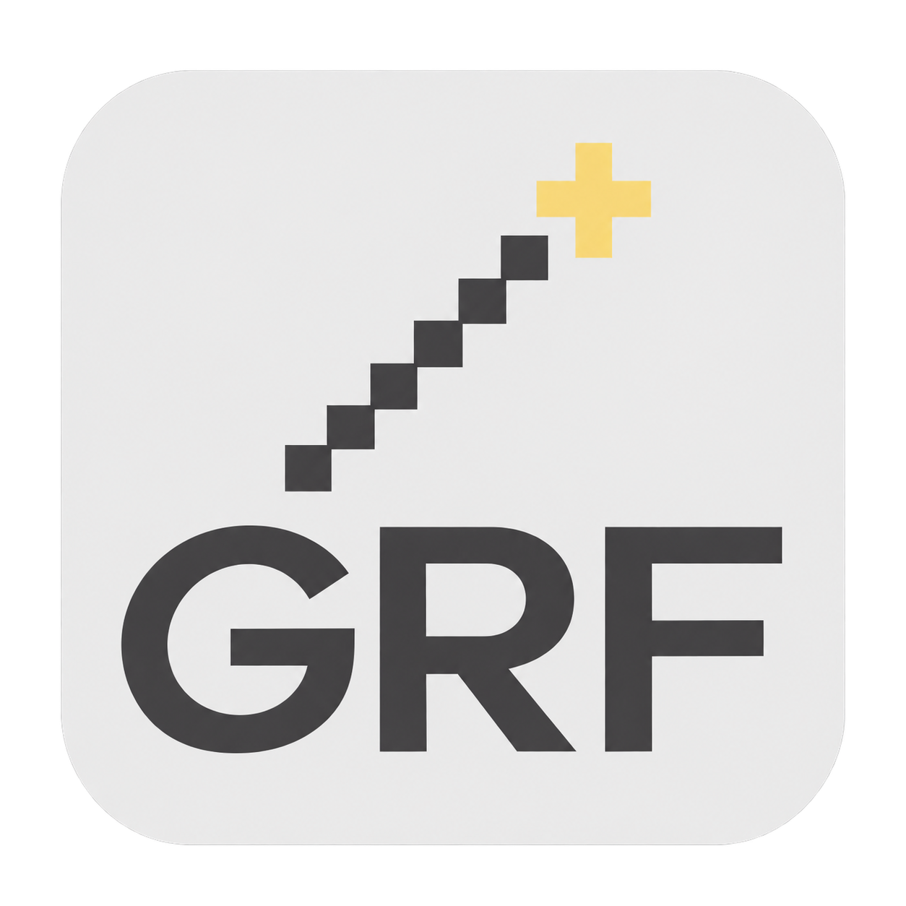
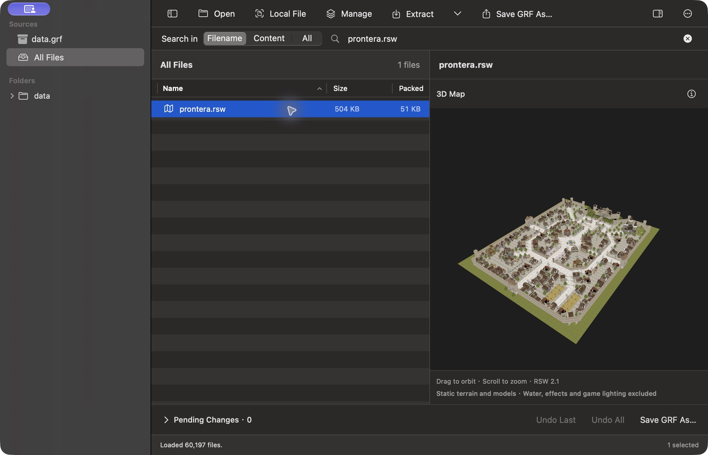
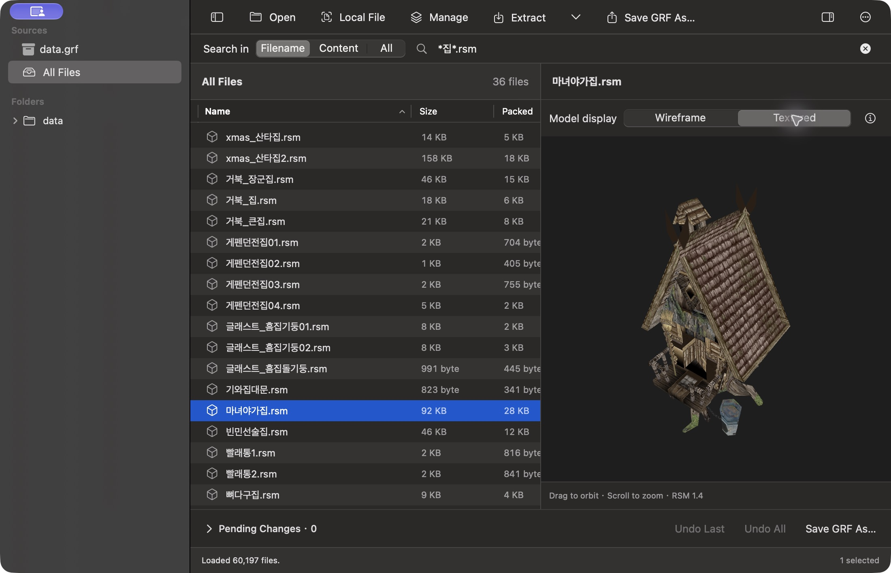
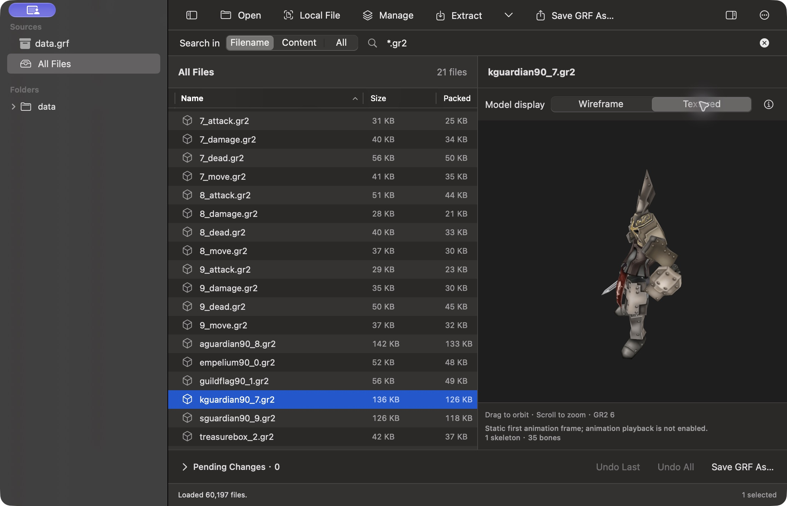
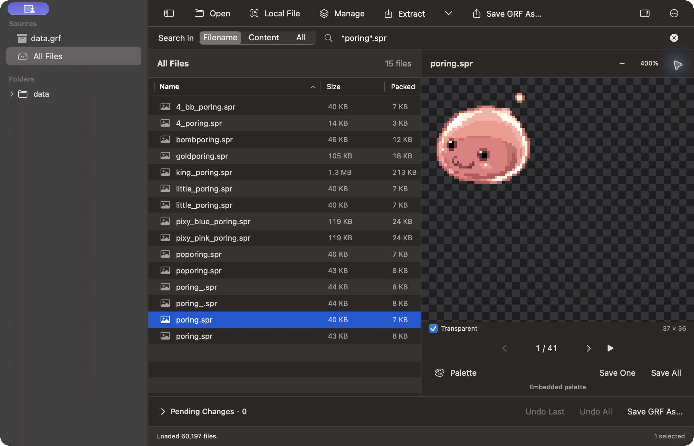

# GRF Tool for macOS

[English](README.md) · [繁體中文](README.zh-TW.md) · [日本語](README.ja.md) · **한국어** · [Credits](credit.md)



Ragnarok Online의 GRF/GPF를 탐색하고 미리 보고 편집하는 네이티브 macOS 앱입니다. 파일 이름과 텍스트 검색, 지도·모델 미리 보기, 압축 풀기, 편집한 아카이브의 사본 저장을 지원합니다.

SwiftUI로 **GRF Tool 1.2.0 (`grftool.exe`)**, **GRFBuilder 0.1.30 (`grfbuilder.exe`)**, **SPRViewer (`SPRViewer.exe`)**의 작업 흐름을 재구성했습니다. Windows, Wine, 계정이나 서버 없이 로컬에서 실행됩니다. 원본 EXE, 게임 리소스, 독점 SDK는 앱에 포함되지 않습니다. 저자·출처·사용 방식은 [Credits(영문)](credit.md)를 참고하세요.

## 시작하기

**macOS 14 이상**이 필요합니다. 소스 빌드에는 **Swift 6**을 포함한 Xcode 또는 Command Line Tools도 필요합니다.

**다운로드:** [GRF Tool v1.5.0(Apple Silicon)](https://github.com/stanleylaihk/GRF-tool/releases/download/v1.5.0/GRFToolMac-1.5.0-macOS-arm64.zip). ZIP 파일을 풀고 **GRF Tool.app**을 응용 프로그램 폴더로 이동하세요. 배포 파일은 Apple Silicon Mac용입니다. Intel Mac에서는 소스에서 빌드해야 합니다. [모든 릴리스](https://github.com/stanleylaihk/GRF-tool/releases)도 확인할 수 있습니다.

소스에서 빌드하려면:

```sh
git clone https://github.com/stanleylaihk/GRF-tool.git
cd GRF-tool
./build-app.sh
open "release/GRF Tool.app"
```

빌드 스크립트는 현재 Mac의 아키텍처를 대상으로 합니다. Apple Silicon과 Intel은 별도로 빌드하세요. 결과물에는 로컬 ad-hoc 서명만 있으며 Developer ID 서명과 공증은 포함되지 않습니다. Finder에서 파일을 열려면 패키징한 `.app` 사용을 권장합니다. 개발 시 `swift run GRFToolMac`도 사용할 수 있습니다.

1. **열기(Open)**를 누르거나 `.grf`/`.gpf`를 창에 끌어 놓습니다.
2. 왼쪽에서 소스나 폴더를 선택합니다. 오른쪽 작업 공간의 위쪽에는 도구 모음과 검색이 있고, 아래쪽에는 파일 목록과 미리 보기가 나란히 표시됩니다.
3. **로컬 파일(Local File)**로 독립 리소스와 같은 폴더의 파일을 탐색할 수 있습니다. 이전에 연 GRF로도 돌아갈 수 있습니다.
4. **압축 풀기(Extract)**를 사용하거나, **관리(Manage)**에서 편집한 뒤 **Save GRF As…**로 새 파일을 저장합니다.

상단에는 아카이브 이름을 중복 표시하지 않습니다. 도구 모음의 빈 공간을 드래그해 창을 이동할 수 있습니다. 컨트롤은 마우스를 올리면 파란색으로 강조되며, 구분선을 드래그해 너비를 조절할 수 있습니다. 사이드바와 미리 보기도 숨길 수 있습니다.

## 인터페이스 언어

**Settings → Interface Language**에서 **English / 繁體中文 / 日本語 / 한국어**를 선택합니다. 즉시 적용되고 선택을 기억하므로 재시작할 필요가 없습니다. 열린 아카이브, 검색, 미리 보기와 저장하지 않은 변경 사항은 유지됩니다.

인터페이스 언어는 파일 이름·내용의 인코딩과 별개입니다. 리소스 이름, 원본 내용, JSON, 라이선스 원문과 인식되지 않은 저수준 진단 메시지는 번역하지 않습니다.

## 탐색과 검색

- 폴더 트리, 다중 선택, 파일 크기·압축 크기, 전체 경로 복사를 지원합니다. 일부 한국어 폴더에는 영문 힌트가 붙지만 실제 경로는 변경하지 않습니다.
- **Filename**은 이름/경로를 즉시 검색하며 `*`, `?`를 지원합니다. 예: `*.spr`.
- **Content / All**은 Enter나 검색 버튼으로 실행합니다. 추가·교체한 초안까지 포함해 현재 소스 전체의 텍스트를 검색하며 폴더 필터에 제한되지 않습니다.
- 결과에는 줄 번호, 미리 보기와 일치 횟수가 표시되며 이전/다음 결과로 이동할 수 있습니다. 진행률과 취소를 지원합니다. 바이너리와 **16 MiB를 넘는 텍스트**는 건너뛰고 보고합니다.
- 큰 GRF를 열 때는 인덱스부터 읽고 진행률/취소를 제공합니다. 전체 아카이브를 한 번에 메모리에 올리지 않습니다.

## GRF 만들기와 편집

- **New GRF / ⌘N**: 빈 아카이브 만들기.
- **Manage**: 파일/폴더 추가, GRF 병합, 교체, 이름 변경, 삭제. 병합 시 중복 경로는 기존 항목 유지·교체·병합 취소 중 선택할 수 있습니다.
- **Pending Changes**: 변경 수를 표시하며 항목별, 마지막 작업, 전체 실행 취소를 지원합니다. 목록과 미리 보기에 초안이 즉시 반영됩니다.
- **Extract**: 현재 초안의 내용을 출력합니다. 삭제한 리소스는 제외하고 교체한 리소스는 새 데이터를 사용합니다.
- **Save GRF As…**: 표준·비암호화 **GRF 2.0**을 새 파일로 저장한 뒤 엽니다. **Repack As…**는 인덱스와 압축 데이터를 재구성하지만 크기가 줄어든다고 보장하지는 않습니다.

초안은 메모리에만 보관됩니다. 원본 GRF와 병합 소스를 직접 수정하지 않으며, 저장하지 않은 상태로 떠나면 확인합니다. 저장은 취소할 수 있고 실패 시 초안과 기존 대상 파일을 유지합니다.

**⌘,**로 설정을 열어 **Default (balanced)** 또는 압축 수준 **0–9**를 선택하세요. 0은 압축 안 함, 1은 가장 빠름, 9는 최대 압축입니다. 다음 저장/재압축에 적용하며 기존 파일은 바꾸지 않습니다.

## 리소스 미리 보기

GRF 항목을 선택하거나 독립 파일을 여세요. 연결된 모델·텍스처가 필요하면 로컬 `data` 폴더 구조를 유지하세요. 누락된 리소스는 보고합니다. 3D 장면은 회전·확대/축소와 정보/JSON 보기를 지원합니다.

다음 이미지는 v1.5.0의 영어 인터페이스입니다. 게임 이미지는 설명용으로만 사용되고 리소스 원본은 앱에 포함되지 않습니다.

### RSW: 3D 지도

**RSW 1.2–2.1**의 GND 지형, RSM 모델, 텍스처를 조합하고 위치·회전·배율을 반영합니다. 수면, 효과, 완전한 게임 조명과 애니메이션은 재현하지 않습니다.



### RSM: 3D 모델

**RSM 1.1–1.4** 정적 모델을 지원합니다. **Wireframe / Textured** 탭을 제공하며 기본값은 와이어프레임입니다. 키프레임 애니메이션 재생은 지원하지 않습니다.



### GR2: Granny 모델

RO의 **GR2 v6, little-endian, 32-bit**를 지원합니다. 내장 RAW/IGC 텍스처, 재질 그룹, UV와 스키닝한 첫 프레임 포즈를 표시합니다. **Wireframe / Textured**의 기본값은 와이어프레임입니다. 동작 파일은 현재 소스나 로컬 `data`에서 유일한 기본 모델을 찾으며, 누락되면 안내합니다.

애니메이션 재생과 다른 Granny 버전/압축 방식은 지원하지 않습니다. 네이티브 Swift Oodle-0과 내장 오픈 소스 리더를 사용하므로 독점 Granny SDK나 Windows DLL이 필요하지 않습니다.



### SPR: 스프라이트

**SPR 1.0/1.1, 2.0, 2.1**의 투명도, 확대/축소, 프레임 선택과 순환 재생을 지원합니다. **Save One / Save All**은 BMP를 출력합니다. 불투명 인덱스 이미지는 256색을 유지하고, 투명 이미지는 alpha BMP를 사용합니다. 동작 합성은 연결된 ACT를 여세요.

SPR/ACT 제목 오른쪽의 **− 배율 +**로 확대/축소하며, 배율을 누르면 **100%**로 돌아갑니다. 아래쪽에는 파일 이름·크기를 중복 표시하지 않습니다.



### Palette 메뉴

| 항목 | 용도 |
| --- | --- |
| Load PAL File… | 로컬 `.pal`을 현재 미리 보기에 적용합니다. |
| Choose PAL from Archive… | 현재 GRF에서 선택합니다. PAL이 없으면 비활성화됩니다. |
| Reset Palette | SPR의 내장 팔레트로 복원합니다. |
| Change Matching SPR… | ACT에 연결된 SPR을 직접 변경합니다. |

팔레트와 SPR 변경은 미리 보기에만 적용됩니다. PAL은 주로 인덱스 색상 이미지에 작용하며 트루 컬러 부분은 바뀌지 않을 수 있습니다.

### 기타 형식

| 형식 | 기능 |
| --- | --- |
| BMP/JPEG 등 시스템 지원 이미지 | 이미지 표시. |
| TXT/XML/JSON 등 | 인코딩 선택, 검색 결과 이동, 지원되는 JSON 서식 지정. |
| WAV | 오디오 재생. |
| PAL | 256색과 색상 값 확인, SPR/ACT에 적용. |
| ACT 1.1, 2.0–2.5 | 같은 이름의 SPR 자동 연결, 동작/방향, 지정 속도 재생, 레이어 위치·반전·배율·회전·색조. SPR 직접 선택 가능. |
| Lua/LUB | 텍스트 또는 Lua 5.1 bytecode의 함수·상수·명령 표시. 디스어셈블이며 원본 소스 복원은 아닙니다. |
| GAT 1.2/1.3 | 통행 가능 여부, 지형, 좌표, 네 모서리 높이. |
| GND 1.6–1.9 | 위에서 본 높이, 텍스처·조명 통계. 조합된 장면은 RSW로 확인합니다. |
| IMF 1.01 | 레이어/프레임 원점. 이미지나 애니메이션은 재구성하지 않습니다. |
| FNA | 참조 경로와 JSON 정보. |
| 기타/지원되지 않는 디코딩 데이터 | Info / Strings / Hex. Hex는 처음 64 KiB를 표시합니다. |

GAT/GND는 **Preview / Info / JSON**, 창에 맞추기·확대/축소, 클릭 또는 X/Y 셀 선택, 전체 셀·표면의 **Export JSON…**을 지원합니다. ACT 사운드 이벤트와 앵커는 정보로만 유지하며 이벤트 오디오나 머리·몸 등의 자동 조립은 지원하지 않습니다.

## 파일 이름과 내용 인코딩

이름은 정상인데 내용만 깨지면 **Text Encoding**, 폴더/파일 이름이 깨지면 **Archive Filename Encoding**을 변경하세요.

**More (⋯) → Text / Filename Encoding…**의 파일 이름 설정은 소스를 다시 읽으며 내부 리소스 참조 이름에도 적용됩니다. 원본 아카이브를 다시 쓰지는 않습니다.

| 파일 이름 인코딩 | 용도 |
| --- | --- |
| Korean (CP949) | 기본값. 원본 한국어 RO 이름. |
| Unicode (UTF-8) | UTF-8 이름으로 만든 아카이브. |
| Traditional Chinese (Big5) | Big5 파일 이름. |
| Western (Latin-1) | 알려진 Latin-1 이름 또는 단일 바이트 해석 확인. |

한국어 이름과 번체 중국어 설명을 함께 쓴다면 보통 **CP949 파일 이름 + CP950/Big5 내용**을 선택합니다.

미리 보기 위쪽의 **Text Encoding**은 **Automatic / UTF-8 / CP949 / CP950·Big5 / UTF-16 / Latin-1 / Mixed Big5 / Korean (per line)**을 지원합니다. 자동 판별은 Unicode·CP949·CP950을 시도한 뒤 엄격한 디코딩에 실패하면 줄 단위 혼합 복원을 시도합니다. 혼합 복원은 추정이며 경고가 표시됩니다. 원본 바이트나 파일 이름은 변경하지 않습니다.

- 빌더에서는 가져오기와 출력 인코딩을 별도로 선택할 수 있습니다.
- 빌더의 **Output Filenames**는 출력 이름을 설정합니다. 작업 공간의 저장/재압축은 현재 파일 이름 인코딩을 사용합니다. UTF-8은 게임 클라이언트 지원이 필요합니다.
- 이름을 손실 없이 변환할 수 없거나 형식의 길이 제한을 넘으면 중단합니다.
- 압축 풀기는 보통 Unicode 이름을 사용합니다. 원본 바이트 모드는 UTF-8 호환 이름에 한정됩니다. macOS가 한국어 ANSI 이름을 거부하면 Unicode를 사용하세요.

인코딩을 바꿔도 손상된 데이터, 알 수 없는 암호화나 지원하지 않는 압축을 복구할 수는 없습니다.

## 호환성과 제한

- **GRF 1.0–1.3 / 2.0**과 표준 mixed/header DES를 읽고 비암호화 **GRF 2.0**을 출력합니다. GRF 3.x와 알 수 없는 사용자 정의 암호화는 지원하지 않습니다. 인덱스를 읽을 수 있어도 내용을 디코딩할 수 있다는 뜻은 아닙니다.
- 폴더 압축 풀기는 구조를 유지하고 기존 파일을 덮어쓰지 않습니다. 충돌하면 중단하며 완료한 파일은 남깁니다. 단일 파일의 **Extract File As…**는 저장 대화상자에서 교체를 확인합니다.
- 개별 디코딩 실패는 건너뛰고 보고합니다. 위험한 경로, 디스크 오류와 취소는 작업을 중단합니다. 저장 중 읽을 수 없는 리소스를 알리지 않고 버리지는 않습니다.
- 잘못된 기존 경로는 탐색할 수 있어도 저장 전에 수정해야 합니다. 심볼릭 링크, 경로 이탈과 경로 충돌은 거부합니다.
- 일반 미리 보기 **64 MiB/파일**, 압축 풀기/쓰기 **512 MiB/리소스**, 인덱스 **256 MiB**, 출력 **4 GiB**.
- 일반 텍스트 **2 MiB**, Lua 텍스트 **512 KiB**, Lua 5.1 bytecode **16 MiB / 10,000줄**. 잘린 경우 표시하며 압축 풀기는 전체 바이트를 유지합니다.
- SPR 디코딩 **256 MiB**. GAT/GND는 한 변 **2,048셀**, 전체 **1,000,000셀**까지입니다. 조합 장면에는 추가 리소스·형상 제한이 있습니다.

## 개발과 검증

```sh
./test.sh
# 선택적인 로컬 테스트 자료. 게임 파일은 리포지토리에 추가되지 않습니다.
GRF_DEMO_DIR=/absolute/path/to/grf ./test.sh
```

v1.5.0의 **108개 테스트**는 번역·설정 저장, 아카이브, 암호화, 인코딩, 초안 실행 취소, 검색, 안전한 압축 풀기, 취소와 리소스 해석을 다룹니다. 선택적 코퍼스 테스트는 로컬 자료가 필요하며 미지정 시 해당 자료를 검증하지 않고 종료할 수 있습니다. GR2 연구에서는 제공된 21개 파일을 검증했습니다. 모든 게임 클라이언트와의 호환성을 보장하지는 않습니다.

[작업 공간](docs/workspace-ui.md) · [GRF 만들기](docs/grf-building.md) · [지도](docs/map-preview.md) · [장면/모델](docs/scene-preview.md) · [재구성](docs/reconstruction.md) · [스프라이트 연구](docs/preview-investigation.md) · [Oodle-0](research/oodle0/README.md) · [GR2 리더](scripts/granny-preview/README.md)

기술 문서는 번체 중국어나 영어일 수 있습니다. 일반 빌드에는 Node.js/npm이 필요하지 않습니다. 내장 GR2 리더를 다시 생성할 때만 esbuild 0.25.0을 사용합니다. 개인 GRF/GPF, 게임 리소스, `.build/`, `release/`는 커밋하지 마세요.

## 크레딧과 라이선스

**GPL-2.0-or-later**. [LICENSE](LICENSE), [Credits(영문 전용)](credit.md), [타사 고지](THIRD_PARTY_NOTICES.md)를 참고하세요. 앱의 **More (⋯) → Credits & Sources…**에도 저자·용도·출처와 원본 도구를 표시합니다.

REA는 제공된 Windows 도구를 개발 중 조사하는 데 사용했습니다. 원본의 모든 동작이나 게임 렌더링을 완벽히 재현한다고 주장하지 않습니다. 원본 EXE나 SDK는 배포하지 않으며 스크린샷의 게임 이미지에 대한 소유권도 주장하지 않습니다.

[프로젝트](https://github.com/stanleylaihk/GRF-tool) · [문제 보고](https://github.com/stanleylaihk/GRF-tool/issues/new) · [Credits](credit.md)
