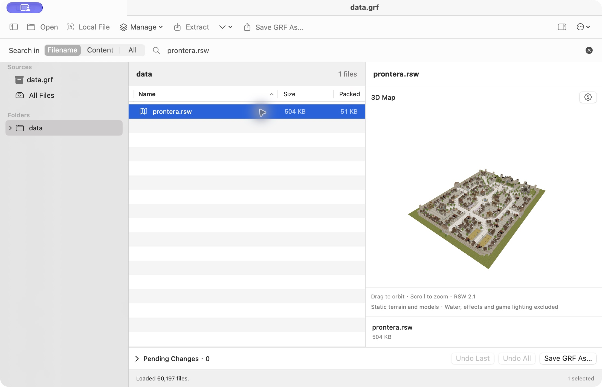
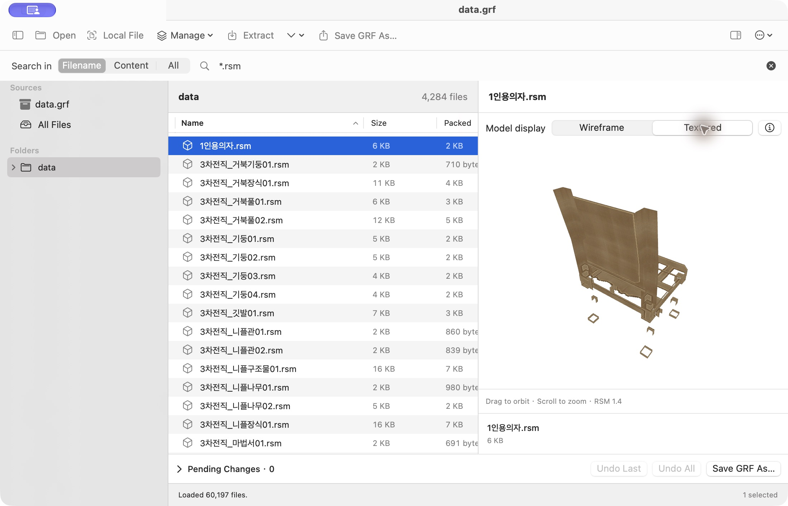
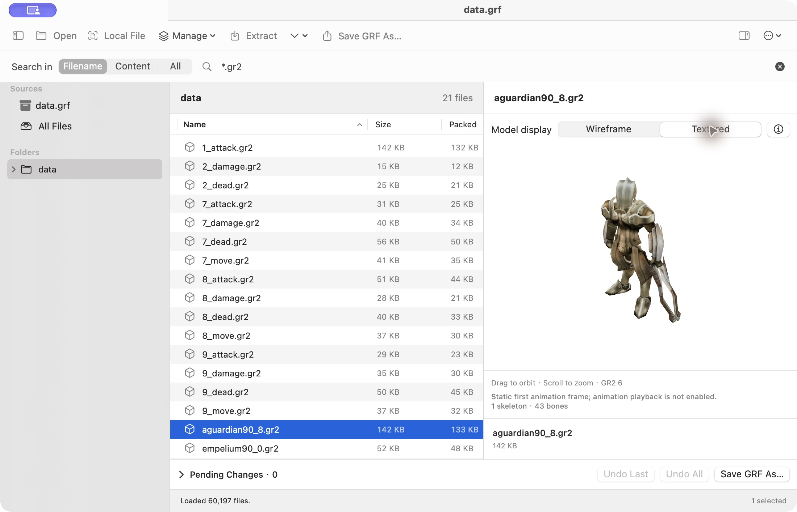
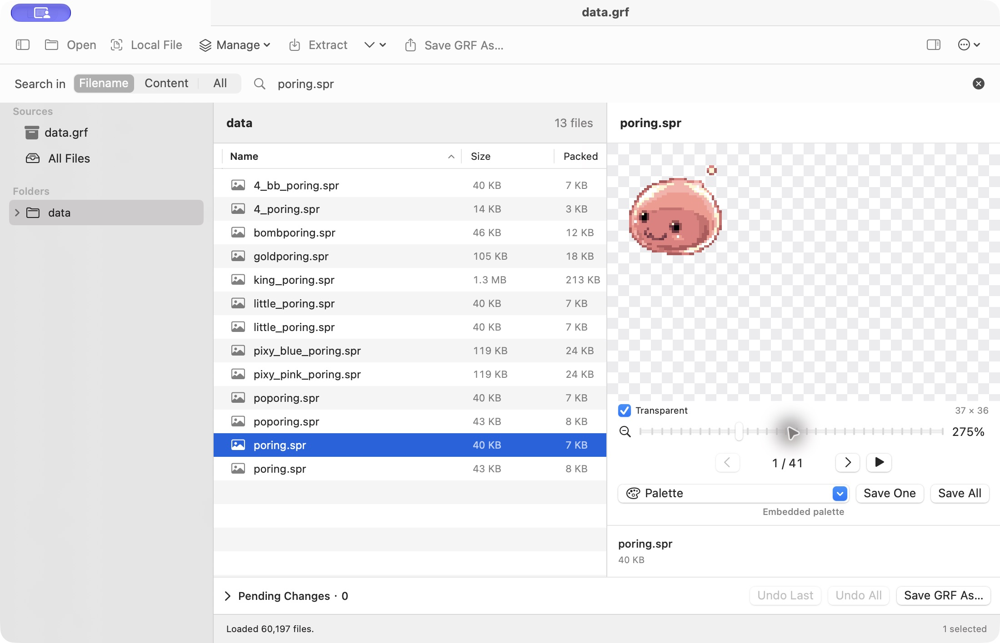

# GRF Tool for macOS

原生 macOS《仙境傳說 RO》資源管理及預覽工具。用一個 App 瀏覽 GRF／GPF、搜尋文字、預覽地圖及角色資源，再解包或另存修改後嘅 GRF。

以 SwiftUI 重建舊 Windows 工具嘅工作流程，整合 **GRF Tool 1.2.0（`grftool.exe`）**、**GRFBuilder 0.1.30（`grfbuilder.exe`）** 同 **SPRViewer（`SPRViewer.exe`）** 嘅主要用途，並加入場景、模型、動作及文字編碼預覽。呢個係原生重建嘅 App，唔係將 EXE 包裝後執行；唔需要 Windows、Wine、帳戶或伺服器，所有資源都喺本機處理。

## 開始使用

需要 **macOS 14 或以上**。由原始碼編譯另需包含 **Swift 6** 嘅 Xcode／Command Line Tools。

```sh
cd GRFToolMac
./build-app.sh
open "release/GRF Tool.app"
```

亦可以用 `swift run GRFToolMac` 開發；日常使用建議開打包後嘅 `.app`，以支援 Finder 開檔。

1. 按 **Open** 或拖入 `.grf`／`.gpf`。
2. 喺左欄揀來源或資料夾，中欄揀檔案，右欄即時預覽。
3. 用 **Local File** 開獨立資源；同一資料夾嘅檔案會列喺中欄，亦可以切返已開啟嘅 GRF。
4. 用 **Extract** 解包，或透過 **Manage** 修改工作副本，再按 **Save GRF As…** 另存。

編譯腳本預設只建立目前主機架構嘅版本；Apple Silicon 同 Intel 要分別編譯。產物使用本機 ad-hoc 簽署，未包含 Developer ID 簽署或公證。

## 主要功能

### 瀏覽及搜尋

- 三欄介面：來源／資料夾、檔案清單、預覽；支援多選、檔案大小、壓縮大小及複製完整路徑。
- 樹狀資料夾導覽；部分已知韓文資料夾附英文提示，實際路徑保持原樣。
- **Filename** 即時搜尋檔名／路徑，支援 `*`、`?`，例如 `*.spr`。
- **Content／All** 按 Enter 或搜尋按鈕執行，搜尋目前來源嘅文字資源，包含新增及取代內容；提供進度、取消、行號、摘要及命中數，預覽內可跳到上一個／下一個命中。
- 內容搜尋涵蓋整個目前來源，唔受資料夾篩選限制；二進位及超過每檔 16 MiB 嘅內容會跳過並顯示數量。
- 開啟大型 GRF 時先讀索引，顯示載入進度並可取消，唔會一次載入整個封包。

### 建立及編輯 GRF

- **New GRF／⌘N** 建立空白封包。
- **Manage** 新增檔案／資料夾、合併 GRF、取代、重新命名及刪除資源。
- 合併時可保留原檔、用匯入檔取代，或拒絕重複路徑。
- **Pending Changes** 顯示待儲存改動，可撤銷單項、最近一次或全部；修改即時反映喺清單及預覽。
- **Extract** 輸出目前草稿內容；已刪除資源唔會解包，已取代資源會使用新內容。
- **Save GRF As…** 另存標準、未加密嘅 **GRF 2.0**，完成後自動開啟新封包。重新打包會重建索引及壓縮資料，清除未被索引引用嘅空間，但唔保證檔案一定更細。

所有修改先保留喺記憶體工作副本，唔會直接修改來源 GRF 或合併來源。未儲存離開前會提示；儲存可取消，錯誤會保留草稿及現有目的檔。

**壓縮設定：** 用 `⌘,` 開 Settings，選 **Default (balanced)** 或 **0–9**：0 唔壓縮、1 最快、9 最高壓縮。設定會記住，套用到下一次儲存；實際速度及大小視資源內容而定。

## 資源預覽

直接選取 GRF 內資源，或用 **Local File** 開獨立檔案。場景／模型可拖曳旋轉、滾動縮放；資料按鈕可查看解碼資訊／JSON。獨立資源需要配套貼圖或模型時，請保留本機 `data` 資料夾結構；缺失資源會喺報告列出。

以下係 App 實際預覽畫面；遊戲資源只用作展示，唔包含喺 App 內。

### `.rsw` — 3D 地圖場景

支援 **RSW 1.2–2.1**，組合 GND 地形、RSM 模型同貼圖，保留物件位置、旋轉及縮放。以下係 `prontera.rsw` 嘅靜態場景；未重現遊戲水面、特效、完整光照或動畫。



### `.rsm` — 3D 模型

支援 **RSM 1.1–1.4** 靜態模型，提供 **Wireframe／Textured** 兩種顯示，預設線框。以下展示貼圖模式；未提供模型關鍵幀動畫播放。



### `.gr2` — Granny 模型

支援 RO 使用嘅 **GR2 v6 little-endian 32-bit** 模型、內嵌 RAW／IGC 貼圖、材質群組、UV 及靜態第一幀姿勢。提供 **Wireframe／Textured**，預設線框。動作檔會嘗試由目前來源或本機 `data` 根目錄配對唯一嘅基礎模型；缺少配套會提示。

目前未提供 GR2 動畫播放，其他 Granny 版本或壓縮方式可能不支援。解碼使用原生 Swift Oodle-0 及內置開源解析器，唔需要專有 Granny SDK 或 Windows DLL。



### `.spr` — Sprite 圖像

支援 **SPR 1.0／1.1、2.0、2.1**，提供透明背景、縮放、逐格切換及循環播放。可由 **Palette** 套用外部 PAL 色板，並用 **Save One／Save All** 匯出單格或全部 BMP。

不透明 indexed 圖像匯出時保留 256 色；透明圖像使用帶 alpha 嘅 BMP。SPR 循環播放係逐張圖片格切換；要睇動作圖層合成，請開配對嘅 ACT。



### 其他預覽格式

| 格式 | 功能 |
| --- | --- |
| BMP／JPEG 等系統支援圖片 | 圖片預覽 |
| TXT／XML 等文字 | 編碼切換、內容搜尋命中導覽 |
| WAV | 音效播放 |
| PAL | 256 色色板、顏色數值，可套用到 SPR／ACT |
| ACT 1.1、2.0–2.5 | 自動配對同名 SPR；動作／方向切換、按檔案時間播放；位置、鏡像、縮放、旋轉及染色合成，亦可手動指定 SPR |
| Lua／LUB | 文字原始碼；Lua 5.1 bytecode 顯示函數、常數及指令清單，屬於反組譯預覽，唔係還原原始碼 |
| GAT 1.2／1.3 | 通行格仔圖、座標、地形類型及四角高度 |
| GND 1.6–1.9 | 俯視高度圖、貼圖及光照統計；完整貼圖場景請開對應 RSW |
| IMF 1.01 | 圖層／圖片格原點及座標，唔會重建 sprite 圖像或動畫 |
| FNA | 引用路徑及 JSON 資料 |
| 其他／無法解析資源 | Info／Strings／Hex；Hex 顯示首 64 KiB |

GAT／GND 提供 **Preview／Info／JSON**、Fit／縮放、點選格仔或輸入 X／Y，亦可以 **Export JSON…** 匯出全部格仔及相關資料。ACT 音效事件同錨點只保留為資料，唔會播放事件音效或自動組裝頭、身體等多個部件。

## 編碼選項：檔名同文字內容分開設定

舊 RO 資源經常混用韓文同繁體中文編碼。**檔名正常但內文亂碼**，應該改文字內容編碼；**資料夾或檔名亂碼**，就改封包檔名編碼。兩者互相獨立。

### 1. Archive Filename Encoding — 封包檔名

喺工具列 **More（⋯）→ Text / Filename Encoding…**，再選擇 **Archive Filename Encoding**。切換後會重新載入來源，以所選編碼解讀檔名；場景內引用嘅資源名稱亦會使用呢個設定。

| 選項 | 幾時使用 |
| --- | --- |
| **Korean (CP949)** | 預設；原版韓文 RO 資料夾及資源名稱 |
| **Unicode (UTF-8)** | 以 UTF-8 建立嘅封包 |
| **Traditional Chinese (Big5)** | 檔名本身使用繁體中文 Big5 嘅封包 |
| **Western (Latin-1)** | 已知使用 Latin-1 嘅來源，或檢查其單位元組解讀結果 |

改呢個選項只影響讀取方式，唔會改寫來源檔名。韓文檔名配繁體中文內文時，通常應保留 **CP949 檔名**，另外將文字預覽揀做 **CP950／Big5**。

### 2. Text Encoding — 文字預覽內容

喺文字預覽上方，或 **More（⋯）→ Text / Filename Encoding…** 選擇 **Text Encoding**；預覽會顯示實際使用嘅編碼。

| 選項 | 用途 |
| --- | --- |
| **Automatic** | 自動嘗試 Unicode、CP949、CP950；嚴格解碼都失敗時，再嘗試逐行中韓文混合復原 |
| **UTF-8** | UTF-8 文字 |
| **Korean (CP949)** | 韓文文字 |
| **Traditional Chinese (CP950 / Big5)** | 繁體中文物品說明、對話及文字表 |
| **UTF-16** | UTF-16 文字 |
| **Western (Latin-1)** | Latin-1 文字 |
| **Mixed Big5 / Korean (per line)** | 同一檔案混有 Big5 中文段落同 CP949 韓文段落時，逐行嘗試復原 |

混合復原會用解碼結果及語言特徵作推測，畫面會顯示警告；有歧義嘅行可能判斷錯誤，可以切返單一編碼核對。所有文字選項只影響預覽及內容搜尋，唔會修改原始位元組，亦唔會改變 GRF 檔名。

### 3. 匯入、儲存及解包檔名

- **匯入編碼**：合併來源可以獨立選擇編碼，唔需要同輸出相同。
- **Output Filenames**：建立封包視窗可設定輸出檔名編碼；主工作區嘅 **Save GRF As…／Repack As…** 則沿用目前 **Archive Filename Encoding**。可選 CP949、UTF-8、Big5、Latin-1，App 預設 CP949；UTF-8 需要遊戲客戶端支援。
- 名稱必須可以無損轉換到所選輸出編碼，並符合格式長度限制，否則會停止並提示。
- **解包到 Finder**：預設使用 Unicode 檔名。原始位元組模式只適用於 UTF-8 相容名稱；macOS 唔接受原始韓文 ANSI 名稱時，請改用 Unicode。

改編碼唔會修復損壞內容、自訂加密或不支援嘅壓縮方式。

## 相容性及保護措施

- 讀取 GRF 1.0–1.3、2.0，包含標準 mixed/header DES 相容處理；寫入未加密 GRF 2.0。
- 未支援 GRF 3.x 或未知自訂加密。部分 `cloud_*.grf` 雖然可讀索引，內容仍需要對應解碼器／key。
- 資料夾解包保留目錄結構，唔會覆蓋現有檔案；衝突會停止，已完成檔案會保留。單檔 **Extract File As…** 可透過系統儲存視窗確認覆蓋。
- 批次解包遇到無法解壓嘅個別資源會跳過，最後列出成功數量及失敗路徑；危險路徑、磁碟錯誤或取消仍會停止。
- 儲存會拒絕損壞或未知加密資源，唔會靜默丟棄。舊封包異常路徑可瀏覽，但儲存前要修正；符號連結、危險路徑及路徑衝突會拒絕。
- 一般預覽單檔上限 64 MiB、解包／儲存單一資源上限 512 MiB、索引上限 256 MiB、GRF 輸出上限 4 GiB。
- 文字預覽上限 2 MiB；Lua 文字 512 KiB；Lua 5.1 bytecode 16 MiB／最多 10,000 行。截斷會標示，解包保留完整原始內容。
- SPR 解碼總大小上限 256 MiB。GAT／GND 每邊最多 2,048 格、合共 1,000,000 格；RSW 組合場景另有相依資源及幾何數量上限。

## 開發及驗證

```sh
./test.sh
# 可選：指定本機測試資源，唔會將遊戲檔案複製入專案
GRF_DEMO_DIR=/absolute/path/to/grf ./test.sh
```

測試涵蓋封包讀寫、標準加密、編碼、草稿復原、搜尋、解包保護、取消，以及 sprite、動作、地圖、場景及模型解析。實際遊戲客戶端執行相容性未經全面驗證。

| 文件 | 內容 |
| --- | --- |
| [工作區](docs/workspace-ui.md) | 管理、待儲存改動、搜尋及目前場景預覽行為 |
| [建立及重新打包](docs/grf-building.md) | 格式、壓縮、寫入保護及驗證 |
| [地圖預覽](docs/map-preview.md) | GAT／GND、座標及 JSON 匯出 |
| [場景及模型研究](docs/scene-preview.md) | 格式研究、GR2 及混合文字復原紀錄；目前 RSW／RSM 組合預覽以工作區文件為準 |
| [重建功能對照](docs/reconstruction.md) | 原始 GRF Tool 靜態分析及驗證範圍 |
| [Sprite 預覽研究](docs/preview-investigation.md) | SPR／PAL／ACT 樣本診斷 |
| [Oodle-0 研究](research/oodle0/README.md) | 原生解壓及原 DLL 結果比對 |

`.build/` 係編譯產物及 SDK 快取，唔代表 App 本身大小。分享 App 可用 `release` 內嘅發佈產物；分享原始碼時唔應加入個人 GRF／GPF、遊戲資源、`.build` 或 `release`。

## REA、參考工具及授權

開發時使用 REA 靜態檢查提供嘅 Windows 工具，配合格式文件、開源參考及測試重建功能；唔宣稱同原版介面或所有執行行為完全一致。原始 EXE 唔隨 App 發佈。

專案採用 **GPL-2.0-or-later**，見 [LICENSE](LICENSE) 及 [第三方聲明](THIRD_PARTY_NOTICES.md)。GRF 加密相容核心源自 OpenKore/grftool；GR2 使用有保留授權聲明嘅開源解析器。App 內 **More（⋯）→ Credits & Sources…** 提供作者、用途、來源連結、原始工具及授權資料。

靜態分析證據見 [GRF Tool](docs/rea-evidence.json) 及 [SPRViewer](docs/preview-rea-evidence.json)。App 唔包含遊戲資源、專有 SDK 或 Windows DLL。
